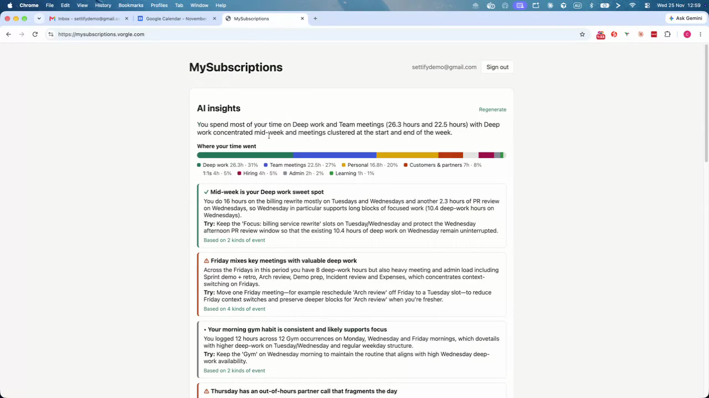

# MySubscriptions

[](https://mysubscriptions.vorgle.com/demo)

**[▶ Watch the demo (1 min 45 s)](https://mysubscriptions.vorgle.com/demo)**: opening the hosted app after it has been idle, signing in with Google, connecting a calendar, and the AI insights arriving stage by stage. The video is served by the app itself, so the link can take up to a minute to open if the app is asleep; the file is also in the repo at `client/public/demo.mp4`.

Sign in, connect your Google Calendar, and AI tells you where your time actually went over the last four weeks: it sorts events into what the time was spent on (deep work, team meetings, 1:1s, customers, hiring, personal…), then points out patterns worth changing, each backed by the events it's based on.

- **Hosted version:** https://mysubscriptions.vorgle.com (free hosting tier: if the app has been idle, the first load can take up to a minute while it wakes up)
- **Demo mode:** click "Try with sample data" to explore without a Google account.

## Setup

Requirements: Node 20+.

1. In Google Cloud console, create a project, enable the **Google Calendar API**, configure the OAuth consent screen (add the scopes `openid`, `email`, `profile` and `calendar.readonly`; either add your account as a test user, or set the publishing status to "In production"), and create an **OAuth client ID** (Web application) with the redirect URI `http://localhost:4000/auth/google/callback`.
2. Copy `.env.example` to `.env` and fill in the values. `OPENAI_API_KEY` is needed for the AI insights; everything else works without it.
3. Install and run:

```bash
npm install
npm run dev        # Express on :4000, React (Vite) on :5173
```

Open http://localhost:5173.

Other scripts: `npm test`, `npm run typecheck`, `npm run build && npm start` (production build served by Express).

## Architecture

```
React (Vite) ──/api, /auth──▶ Express API ──▶ Google OAuth + Calendar API
                                   │
                                   ├── auth/         sign-in and "connect a service", PKCE
                                   ├── connectors/   provider data → our CalendarEvent model
                                   ├── insights/     group → classify (AI) → count (code) → interpret (AI) → check (code)
                                   └── session       tokens stored server-side only
```

- **One origin.** In development Vite proxies `/api` and `/auth` to Express; in production Express serves the built React app. No CORS, and the session cookie stays first-party.
- **Connectors.** Each service converts its data into our own model (`CalendarEvent`), so stats, AI and UI never depend on Google's format. Adding a second service means adding one connector.

## Deployment

One Node web service on Render (`render.yaml`): the build compiles the React app and the API, and Express serves both, behind Render's HTTPS proxy on a custom domain. Secrets are set as environment variables in Render, never in the repo. The in-memory session store means it runs as a single instance; see the plan below for what changes at scale (CloudFront + S3 for the frontend, containers on Fargate for the API, Redis for sessions, Secrets Manager).

## Authentication

- **Two steps, each asking only for what it needs** (Google's incremental authorisation):
  1. **Sign in with Google**: `openid email profile` only. These scopes are non-sensitive, so sign-in works for anyone.
  2. **Connect Google Calendar**: adds **read-only** `calendar.readonly`. The app checks the user actually granted it, and that it's the same Google account they signed in with.
- OAuth 2.0 authorisation code flow with **PKCE** and a random `state` (CSRF protection), done on the server.
- The ID token is verified; the session ID is regenerated on sign-in (prevents session fixation).
- Access and refresh tokens are kept **server-side in the session**; the browser only has an `httpOnly`, `SameSite=Lax`, `Secure` (in production) cookie.
- Expired access tokens are refreshed automatically. Sign-out revokes the Google grant and destroys the session.

## AI implementation

### What it does

A calendar's raw numbers ("31 hours of events") say little. What matters is *what the time was for*, and that lives in messy titles: "sync w/ design", "PR review blitz", "Acme QBR prep". Reading those is something a model is genuinely better at than rules, so that's where the AI goes. Everything that can be computed exactly is computed in code.

```
events ─▶ 1. group by title (code)
          2. classify each kind of event into 9 categories (LLM, structured output)
          3. hours per category / weekday, back-to-back runs, out-of-hours work, focus blocks (code)
          4. interpret those numbers: summary + 3–4 insights with a suggestion and evidence (LLM, structured output)
          5. check: drop insights whose evidence doesn't exist; flag numbers not found in the data (code)
```

The UI shows progress as each stage finishes, a category breakdown, the insights (each with "Based on N kinds of event", expandable), category chips on the event list, and a "How this was made" panel with model, latency, tokens and estimated cost for each step.

### Design decisions

- **The model never does arithmetic.** It gets the numbers and interprets them. The prompt forbids new numbers, and a code check flags any number in an insight that isn't in the data the model saw ("Check numbers" badge). Cheap, automatic, and visible to the user.
- **Every insight must cite evidence.** Insights refer to event groups by short refs (`g3`). The JSON schema only accepts refs that exist (an `enum` built per request), refs are validated again in code, and an insight with no valid evidence is dropped rather than shown.
- **Stream stages, not tokens.** The whole pipeline takes about 20 seconds, mostly the model reasoning before it writes. Streaming tokens would show unchecked text and only help the last few seconds. Instead the server streams one JSON line per finished stage (`POST /api/insights/stream`, NDJSON): the category breakdown appears after about 5 seconds (it's final, because code computed it), and the insights appear once their citations and numbers have been checked. Nothing unverified reaches the screen.
- **Structured outputs + zod.** Both calls use OpenAI's JSON-schema structured output (strict), and the result is validated again with zod. Categories are a fixed enum, so the output is chartable and comparable between runs. Unknown or missing classifications fall back to "other" and are counted in the trace.
- **Two small calls instead of one big one.** Classifying and interpreting are different jobs. Splitting them keeps each prompt short and testable, lets the numbers in step 3 be exact, and shows where time and tokens go.
- **Group before classifying.** Recurring meetings repeat the same title many times; classifying each title once cuts tokens (a typical month is ~20–60 kinds of event, not 100–250 events) and keeps labels consistent.
- **Data minimisation.** The model sees titles (truncated to 80 characters), duration, attendee *count*, recurrence and time of day. Never descriptions, locations, attendee emails or Google event IDs (short refs instead). Logs record usage only, never calendar content. Titles can still contain names; that's the minimum the feature needs and is noted below.
- **Cost and abuse controls.** Results are cached per session until the calendar data changes ("Regenerate" bypasses the cache). There's a per-session hourly limit and a global daily cap, so a public demo link can't run up a bill. Timeouts (45 s), one retry on 429/5xx, and bounded output tokens.
- **Provider behind an interface.** The pipeline depends on a small `LlmClient` interface (`completeJson`). Tests use a scripted fake; another provider is one class.

### Model

`gpt-5-mini` by default (`OPENAI_MODEL`), with low reasoning effort: classification and interpretation of a small JSON summary don't need a frontier model, and a month of calendar costs a fraction of a cent. Costs shown in the UI are estimates from token counts and the prices in `.env` (`OPENAI_INPUT_USD_PER_MTOK`, `OPENAI_OUTPUT_USD_PER_MTOK`).

### What I tried (on the sample calendar, `gpt-5-mini`)

| Run | Change | Result |
|---|---|---|
| 1 | First version, `low` reasoning for both steps | Sensible categories and insights, but vague ("several meetings", "likely"), internal refs leaked into the text ("(g1, g12)"), 30 s, $0.0042 |
| 2 | Prompt: quote numbers, never write refs; `minimal` reasoning for classification; strip refs in code as a backstop | Concrete numbers and 6 s faster, but **all 4 insights were dropped**: the model stopped putting refs in the evidence field too |
| 3 | Evidence field constrained to an `enum` of real refs in the schema | 4 insights, every number found in the data, every citation valid, 22 s, $0.0037 |

Lesson: validation in code caught the failure in run 2 instead of showing unsupported insights; the fix belonged in the schema, not in more prompt text.

### Tracing and evaluation

Each model call writes one structured log line (`step`, `model`, latency, tokens, cost), and the same trace is returned to the UI. The automatic checks (invalid refs, dropped insights, unsupported numbers) are a first, built-in evaluation that runs on every request. A proper eval set and a tracing tool are in the plan below.

### Testing

`npm test` runs the pipeline against a scripted fake model: grouping, classification fallbacks, invented refs, aggregation (shares, back-to-back runs, out-of-hours), the number check, usage limits, cost calculation, that event IDs aren't sent to the model, and that logs contain no calendar content.

## Assumptions

- One service (Google Calendar), primary calendar, last 28 days.
- "Out of hours" means before 8:00 or after 18:00 in the browser's time zone; "back-to-back" means 3+ meetings with 5 minutes or less between them.
- Declined and cancelled events are excluded.
- Event descriptions, locations and attendee emails are not read into the app's model and never sent to the AI.

## Limitations

- Sessions live in memory: restarting the server signs everyone out, and it runs as a single instance. On the free hosting tier the server sleeps after 15 minutes idle, which also ends sessions.
- The Google app isn't verified (verification for the calendar scope takes weeks). Sign-in works for anyone; connecting the calendar shows Google's "unverified app" screen (choose **Advanced → Go to vorgle.com (unsafe)**), and Google limits unverified apps to 100 users. Demo mode works for everyone, with real AI on sample data.
- Event titles are sent to OpenAI and may contain names. A production version would offer a toggle to mask names, and a data-processing note in the privacy policy.
- The number check is a heuristic: a made-up number can pass if it happens to appear in the data.
- Rate limits and caches are in memory, per instance.

## Future enhancements

- **1 more day:**
  - A small **eval set**: 30–50 real-looking calendar titles with hand-labelled categories, plus 5 calendars with expected insights; run it in CI on every prompt or model change and report classification accuracy and unsupported-number rate.
  - **Langfuse tracing** (prompts versioned, every call traced with cost), replacing the log lines.
  - "Mask names before sending to AI" toggle.
  - Hosted on a single instance with Redis-backed sessions.
- **5 more days:**
  - **A second service** (Spotify or GitHub) through the same connector interface, and cross-service insights ("your commits drop on meeting-heavy days").
  - **Week-over-week trends**: store category totals per week (Postgres) and let the AI comment on change, not just a snapshot.
  - **Let the user correct a category**; keep corrections as few-shot examples per user, and as labelled data for the eval set.
  - Compare models (cost, latency, accuracy on the eval set) and pick per step; prompt caching for the fixed system prompts.
  - Google app verification, privacy policy, and Playwright end-to-end tests.
- **20 more days:**
  - **"Fix my week" actions**: the AI proposes concrete calendar changes (move a meeting, protect a focus block) and, with an explicit extra write permission, applies them after the user confirms.
  - **Ask your calendar**: a chat over the user's data with tool calls into the same code-computed aggregates, so answers stay grounded.
  - Team view (opt-in, aggregated): meeting load across a team without exposing individual calendars.
  - Background sync, per-user cost budgets, observability dashboards and alerting, SOC 2-style controls on data retention and deletion.
